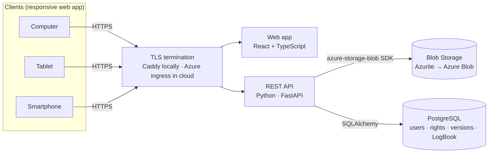
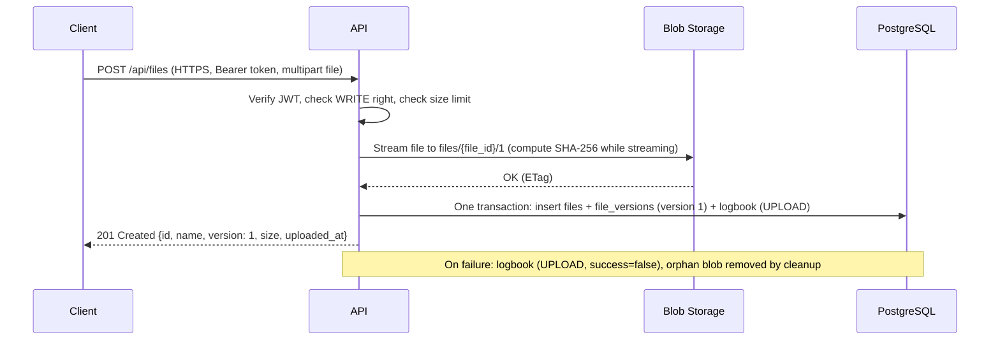
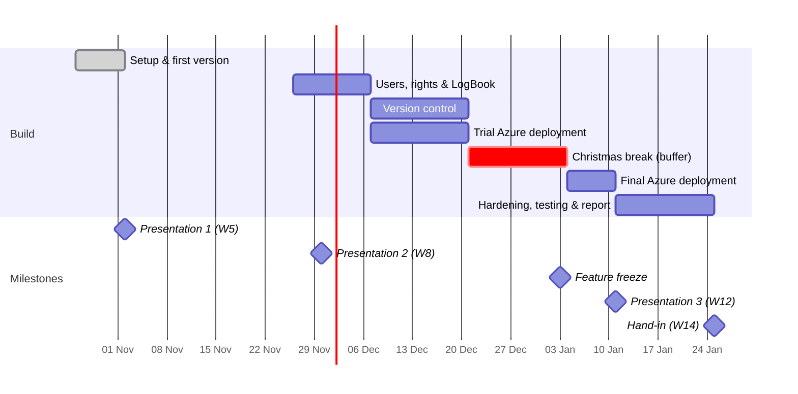

# Development Plan — Cloud File Exchange System

> How we build the system: architecture, requirements, data model, API, schedule and Azure migration.
> Presentation content: [PRESENTATION.md](PRESENTATION.md)

## 1. Goal

A system for exchanging documents and photos between client devices (computer, tablet, smartphone) and the cloud.

- We develop locally with **Docker** and **Azurite** (the official Azure Storage emulator).
- When the system is complete, we migrate it to **Microsoft Azure**.
- The code is written so that the migration needs **configuration changes only**.

## 2. Requirements

### Functional

| ID | Requirement | Requirement level | Ready by |
|---|---|---|---|
| FR1 | Login | Good grade | 6 Dec |
| FR2 | Logout (session really ends: refresh token revoked) | Good grade | 6 Dec |
| FR3 | Upload file | Necessary | Presentation 1 |
| FR4 | Download file | Necessary | Presentation 1 |
| FR5 | List files the user can read | Necessary | Presentation 1 |
| FR6 | Authorization: **read / write / update** rights | Good grade | 6 Dec |
| FR7 | Version control: each version has a number, date and size; list versions | Very good grade | 20 Dec |
| FR8 | Download a specific version; restore an older version | Very good grade | 20 Dec |
| FR9 | LogBook: every login (success and failure), logout and file operation recorded in a database | LogBook (perfect) | 6 Dec |
| FR10 | LogBook export to CSV / JSON; admin view with filters | LogBook (essential) | 6 Dec |
| FR11 | Admin creates / deactivates users | Good grade | 6 Dec |
| FR12 | Owner shares a file with another user (read or update) | Should | 6 Dec (cut if late) |

### Non-functional

| ID | Requirement |
|---|---|
| NFR1 | All traffic over **HTTPS** (TLS 1.2+); plain HTTP refused or redirected |
| NFR2 | Files stored in **Azure Blob Storage** (Azurite locally) |
| NFR3 | Usable on computer, tablet and smartphone browsers (responsive layout) |
| NFR4 | Passwords stored only as **Argon2id** hashes; no secrets in the repository |
| NFR5 | Local → Azure migration with **configuration changes only** |
| NFR6 | Maximum file size **100 MB**; uploads streamed, never loaded fully into memory |
| NFR7 | Blob container is private; files are reachable only through the API |

### Out of scope

Native mobile/desktop apps · background folder sync · real-time co-editing · client-side encryption · self-registration · multi-region deployment.

## 3. Key design decision: versioning in the application

**Azurite does not support** Blob Versions, soft delete, immutability policies or user-delegation SAS ([Azurite README](https://github.com/Azure/Azurite)).

If we relied on Azure's built-in blob versioning, it would work in the cloud but not during local development. So versioning is part of our own code:

- Every upload creates a **new blob that is never modified**: `files/{file_id}/{version_no}`.
- The `file_versions` table stores the version number, date, size, SHA-256 hash and uploader.
- "Restore version n" copies blob n into a new version `current + 1`. The history is never rewritten.

This works the same on Azurite and on Azure.

## 4. Architecture



### Local vs Azure

| Component | Local (Docker Compose) | Azure |
|---|---|---|
| Web client | Vite dev server / static build | Azure Static Web Apps (Free tier) |
| HTTPS | Caddy with its own local CA (`tls internal`) | Managed TLS on Container Apps / Static Web Apps |
| API | `api` container (FastAPI + Uvicorn) | Azure Container Apps (consumption plan) |
| File storage | Azurite (blob service) | Storage account (StorageV2, LRS, secure transfer required, public access disabled) |
| Database | `postgres:16` container | Azure Database for PostgreSQL Flexible Server (Burstable B1ms) |
| Access to storage | Connection string (Azurite's well-known dev key) | **Managed identity** + role `Storage Blob Data Contributor` |
| Secrets | `.env` (gitignored) | Azure Key Vault |
| Monitoring | Container logs | Application Insights |
| Container images | Built locally | GitHub Container Registry (free) or Azure Container Registry |

### Upload flow



## 5. Authentication and authorization

### Login and logout
- **Login** `POST /api/auth/login`
  - The password is checked against an Argon2id hash.
  - The API returns:
    - a short-lived **access token** (JWT, 15 min), sent as `Authorization: Bearer …`
    - a **refresh token** (7 days), set as an `HttpOnly; Secure; SameSite=Strict` cookie and stored **hashed** in `refresh_tokens`
- **Logout** `POST /api/auth/logout` marks the refresh token as revoked. The access token expires within 15 minutes and cannot be renewed. This solves the problem that a JWT on its own can't be cancelled.
- **Brute-force protection:** rate-limit login attempts per IP and per username. Every failed attempt is recorded in the LogBook.

### Rights

| Right | Allows |
|---|---|
| **READ** | See the file in the list, view its versions, download any version |
| **WRITE** | Upload new files |
| **UPDATE** | Upload a new version of an existing file, restore an older version |

| Role | Default rights |
|---|---|
| `viewer` | READ on files shared with them |
| `user` | WRITE; full rights on files they own; READ/UPDATE on files shared with them |
| `admin` | Everything, plus user management and the LogBook |

- File owners grant READ or UPDATE to other users (`file_permissions` table).
- All checks happen in **one place**: a FastAPI dependency `require(right)`. This keeps rules consistent and testable.

## 6. Data model

```sql
users            (id, username UNIQUE, email, password_hash, role, is_active, created_at)
files            (id UUID, owner_id → users, name, content_type, current_version, created_at, deleted_at)
file_versions    (id, file_id → files, version_no, blob_name, size_bytes, sha256,
                  uploaded_by → users, uploaded_at,
                  UNIQUE (file_id, version_no))
file_permissions (file_id → files, user_id → users, can_read, can_update,
                  PRIMARY KEY (file_id, user_id))
refresh_tokens   (id, user_id → users, token_hash, issued_at, expires_at, revoked_at)
logbook          (id, ts, user_id, username, action, file_id, version_no,
                  ip, user_agent, success, details JSONB)
```

- **Blob naming:** container `files`, blob `{file_id}/{version_no}`. User-supplied file names are **never** used as blob paths, which prevents name collisions and path tricks. The original name is stored in `files.name` and sent back in `Content-Disposition` on download.
- **Simultaneous uploads:** the next version number is read with `SELECT … FOR UPDATE` on the `files` row. The `UNIQUE (file_id, version_no)` constraint is the safety net; on conflict, retry.
- **LogBook actions:** `LOGIN`, `LOGIN_FAILED`, `LOGOUT`, `LIST`, `UPLOAD`, `UPDATE` (new version), `DOWNLOAD`, `RESTORE`, `SHARE`, `DELETE`, `USER_CREATE`, `USER_DEACTIVATE`. Entry shape, CSV columns and the logging rules: [API.md](API.md#logentry).

## 7. REST API

| Method | Path | Right | LogBook action |
|---|---|---|---|
| POST | `/api/auth/login` | — | `LOGIN` / `LOGIN_FAILED` |
| POST | `/api/auth/logout` | logged in | `LOGOUT` |
| POST | `/api/auth/refresh` | refresh cookie | — |
| GET | `/api/auth/me` | logged in | — |
| GET | `/api/files` | READ (filters list) | `LIST` |
| POST | `/api/files` | WRITE | `UPLOAD` |
| GET | `/api/files/{id}` | READ | — |
| GET | `/api/files/{id}/versions` | READ | — |
| POST | `/api/files/{id}/versions` | UPDATE | `UPDATE` |
| GET | `/api/files/{id}/download?version=n` | READ | `DOWNLOAD` |
| POST | `/api/files/{id}/versions/{n}/restore` | UPDATE | `RESTORE` |
| PUT | `/api/files/{id}/permissions` | owner | `SHARE` |
| DELETE | `/api/files/{id}` | owner / admin | `DELETE` (soft delete) |
| GET | `/api/logbook?user=&action=&success=&from=&to=` | admin | — |
| GET | `/api/logbook/export?format=csv\|json` | admin | — |
| GET | `/api/users` | admin | — |
| POST | `/api/users` | admin | `USER_CREATE` |
| POST | `/api/users/{id}/deactivate` | admin | `USER_DEACTIVATE` |

FastAPI generates the OpenAPI spec and a Swagger UI at `/api/docs`. We use them for testing and demos.

## 8. Repository layout (target)

```
Cloud-Computing-Systems/
├── README.md
├── docker-compose.yml
├── .env.example
├── Caddyfile
├── api/
│   ├── Dockerfile
│   ├── pyproject.toml
│   ├── app/
│   │   ├── main.py
│   │   ├── config.py        # all settings from environment variables
│   │   ├── db.py
│   │   ├── models.py
│   │   ├── storage/         # the only package that talks to Blob Storage
│   │   ├── auth/            # login, logout, tokens, permission dependency
│   │   ├── files/           # upload, download, list, versions
│   │   └── logbook/         # logging service, admin endpoints, export
│   ├── migrations/          # Alembic
│   ├── scripts/             # one-off checks, e.g. the Azurite versioning evidence
│   └── tests/
├── web/                     # React + TypeScript (Vite)
├── infra/                   # Azure deployment scripts (Bicep or az CLI)
└── docs/
    ├── PLAN.md
    ├── PRESENTATION.md
    ├── storage.md           # storage package: layout, UML, errors
    ├── evidence/            # saved outputs of the scripts in api/scripts/
    └── report/
```

## 9. Local environment

### Docker Compose (sketch)

```yaml
services:
  azurite:
    image: mcr.microsoft.com/azure-storage/azurite
    command: azurite-blob --blobHost 0.0.0.0 --location /data --skipApiVersionCheck
    ports: ["10000:10000"]          # exposed for Azure Storage Explorer
    volumes: [azurite-data:/data]

  db:
    image: postgres:16
    environment:
      POSTGRES_DB: cloudfiles
      POSTGRES_USER: cloudfiles
      POSTGRES_PASSWORD: ${POSTGRES_PASSWORD}
    volumes: [db-data:/var/lib/postgresql/data]

  api:
    build: ./api
    env_file: .env
    depends_on: [azurite, db]

  web:
    build: ./web

  caddy:
    image: caddy:2
    ports: ["80:80", "443:443"]
    volumes:
      - ./Caddyfile:/etc/caddy/Caddyfile
      - caddy-data:/data
    depends_on: [api, web]

volumes:
  azurite-data:
  db-data:
  caddy-data:
```

```caddy
localhost {
    tls internal
    handle /api/* {
        reverse_proxy api:8000
    }
    handle {
        reverse_proxy web:5173
    }
}
```

### Configuration (environment variables)

| Variable | Local | Azure |
|---|---|---|
| `STORAGE_AUTH` | `connection_string` | `managed_identity` |
| `BLOB_CONNECTION_STRING` | `DefaultEndpointsProtocol=http;AccountName=devstoreaccount1;AccountKey=<well-known key>;BlobEndpoint=http://azurite:10000/devstoreaccount1;` | — |
| `BLOB_ACCOUNT_URL` | — | `https://<account>.blob.core.windows.net` |
| `BLOB_CONTAINER` | `files` | `files` |
| `DATABASE_URL` | `postgresql+psycopg://cloudfiles:…@db:5432/cloudfiles` | Key Vault reference |
| `JWT_SECRET` | random value in `.env` | Key Vault reference |
| `ACCESS_TOKEN_MINUTES` / `REFRESH_TOKEN_DAYS` | `15` / `7` | same |
| `MAX_UPLOAD_MB` | `100` | `100` |
| `CORS_ORIGINS` | `https://localhost` | Static Web App URL |

The `storage` package (`app/storage/client.py`) builds the client from these settings:
- `connection_string` → `BlobServiceClient.from_connection_string(...)`
- `managed_identity` → `BlobServiceClient(account_url, credential=DefaultAzureCredential())`

The rest of the code never knows which one it's using.

### Known pitfalls

- **Inside Compose, use the service name `azurite`, not `127.0.0.1`.** `UseDevelopmentStorage=true` points to `127.0.0.1`, which fails inside a container.
- `--skipApiVersionCheck` stops Azurite from rejecting requests from a newer SDK.
- The current `.gitignore` (Node template) ignores `.env.*`, which would also ignore `.env.example`. Add `!.env.example`, plus Python entries (`__pycache__/`, `.venv/`, `.pytest_cache/`).
- To test from a phone or tablet, use the machine's LAN hostname instead of `localhost`, and install Caddy's root certificate on the device. Alternatively, test devices against the Azure deployment.
- Neither Uvicorn nor Caddy limits upload size by default, so the API must enforce `MAX_UPLOAD_MB` while streaming.

## 10. Schedule

The work is organised around the course milestones:

| Week | Starts | Milestone |
|---|---|---|
| W5 | Mon 2 Nov | **Presentation 1**: idea, plan and first demo (done) |
| W8 | Mon 30 Nov | **Presentation 2**: progress |
| W12 | Mon 11 Jan | **Presentation 3**: final demo of the finished system on Azure |
| W14 | Mon 25 Jan | **Hand-in**: final report and code |

Course weeks after W8: W9 = 7 Dec, W10 = 14 Dec, Christmas break 21 Dec – 3 Jan, W11 = 4 Jan, W12 = 11 Jan, W13 = 18 Jan, W14 = 25 Jan.

> Older documents and code comments still say "Phase n": 0 = setup, 1 = first working version, 2 and 3 = users, rights & LogBook, 4 = trial Azure deployment, 5 = version control, 6 = final Azure deployment & hardening, 7 = report.



### Up to presentation 1 (W5, 2 Nov) — done

Setup and the first working version: upload → list → download over `https://localhost`.

- [x] Stack (FastAPI + React + PostgreSQL) and team roles agreed
- [x] `docker-compose.yml`, `.env.example`, `Caddyfile`; `.gitignore` fixed
- [x] GitHub Actions: lint + tests, with PostgreSQL and Azurite as service containers
- [x] `app/storage`: create container, streamed upload and download, list
- [x] `users`, `files` and `file_versions` tables with Alembic; admin seeded from environment variables; Argon2id hashing; upload writes version 1
- [x] `POST /api/files`, `GET /api/files`, `GET /api/files/{id}`, `GET /api/files/{id}/download`
- [x] Web page: file list, upload button, download links; served over `https://localhost` through Caddy
- [ ] Not confirmed yet (tick when done): protected `main`; GitHub Projects board; Azure for Students subscription + budget alert; Azure Storage Explorer connected to Azurite

### Presentation 1 → 2 (until W8, Mon 30 Nov)

Presentation 2 shows the progress since presentation 1: what works, what changed in the plan, and the road to the final demo. Anything not ready by Monday moves into the next block; the demo shows what works.

**Day 1 — agree before coding** (A writes it into [API.md](API.md)):
- [ ] `log_event()` signature. Failure entries are committed in their own session, so a rollback can't erase them
- [ ] Auth dependencies the others build on: `current_user`, `require(right)`, `require_admin`. The current `current_user` already returns the admin, so B and C can start against it
- [ ] LogBook entry JSON shape and CSV columns; `USER_DEACTIVATE` action; endpoints to list and deactivate users
- [ ] Migration order: A's migration (`refresh_tokens`, `file_permissions`) merges first and B's `down_revision` points to it. Two migrations made from the same head give Alembic two heads, and the API container fails to start

**Work:**
- [ ] **A:** first pull request, merged by Fri 27 Nov: `refresh_tokens` and `file_permissions` tables + migration, stub `require()` / `require_write` / `require_admin`, a test for a single Alembic head ([API.md](API.md#migration-order)). Second pull request: login, access + refresh tokens (refresh tokens stored hashed in `refresh_tokens`), refresh, logout (revokes the refresh token), `GET /api/auth/me`; `current_user` reads the Bearer token
- [ ] **B:** `logbook` table and `log_event()` service; record client IP and user agent; record failures too (`success = false`)
- [ ] **C:** login page and logout button, against `API.md` until A's pull request lands
- [ ] **D:** new settings (`JWT_SECRET`, …) in `.env.example`, Compose and CI. Real client IP in the LogBook: set `FORWARDED_ALLOW_IPS` so uvicorn trusts only Caddy (unset, every entry gets Caddy's address), and stop publishing the API's port 8000 on the host so the API is reachable only through Caddy over HTTPS
- [ ] **All:** progress slides; live demo of what works with a backup recording (D); timed run-through on Sunday

### Presentation 2 → 3 (W8–W12, 30 Nov – 11 Jan)

Goal: every feature finished and running on Azure, demoed on a computer, a tablet and a smartphone.

#### Users, rights & LogBook (until Sun 6 Dec) · Good grade + LogBook

Authentication and the LogBook are built together, so all four roles work in parallel: the LogBook needs real users anyway (`user_id`, login entries, admin-only endpoints).

**A — authentication & rights**
- [ ] Roles + `file_permissions`; `require(right)` dependency on every endpoint; the file list shows only readable files
- [ ] Login rate limiting from the LogBook: recent `LOGIN_FAILED` entries per username and per IP → `429`. No extra store, and it works with several API replicas on Azure
- [ ] `log_event()` calls in the auth and file endpoints
- [ ] Sharing: `PUT /api/files/{id}/permissions` *(cut if late)*
- [ ] Tests: role × operation matrix, ID-guessing attempts, expired / revoked tokens

**B — LogBook & user administration**
- [ ] `GET /api/logbook` with filters and pagination (admin only)
- [ ] CSV and JSON export; CSV cells starting with `=`, `+`, `-` or `@` get a leading `'` (formula injection)
- [ ] Admin endpoints: create / list / deactivate users; deactivating also revokes the user's refresh tokens
- [ ] Test: scripted scenario of N operations → exactly N entries

**C — web**
- [ ] Token handling (`apiFetch` in [API.md](API.md)); hide actions the user has no right to
- [ ] Admin pages: users (create / deactivate) and LogBook (filters, CSV / JSON export)
- [ ] Share dialog *(cut if late)*

**D — infrastructure**
- [ ] Check the refresh cookie (`Secure; SameSite=Strict; Path=/api/auth`) works through Caddy on `https://localhost`
- [ ] Extend `scripts/smoke_test.sh`: login → upload → download → logout → check the LogBook entry count
- [ ] Azure for Students subscription + budget alert, if not done yet

#### Version control + trial Azure deployment (W9–W10, 7–20 Dec) · Very good grade

**B (lead) — version control**
- [ ] `POST /api/files/{id}/versions` (new version), with `SELECT … FOR UPDATE` + retry on conflict against simultaneous uploads
- [ ] SHA-256 computed while streaming
- [ ] `GET /api/files/{id}/versions`; download by version; restore (copy to a new version)
- [ ] Tests: 3 uploads → versions 1–3 with correct sizes; v1 hash matches the original; parallel uploads get unique numbers

**A**
- [ ] `READ` / `UPDATE` checks on B's version endpoints
- [ ] Security headers (HSTS, `nosniff`, `frame-ancestors`) set in the API, because on Azure there is no Caddy in front of it; CORS limited to our web origin
- [ ] With D: login and refresh working on Azure (see the risk below)

**C**
- [ ] Version history panel (version, date, size, uploader) with Download and Restore

**D (lead) — trial Azure deployment**
- [ ] Deploy the 6 Dec state with the steps in §11
- [ ] Note every local/cloud difference found, and fix it in code or config
- [ ] Scale to zero / stop the database afterwards to save credit

> **Risk: the refresh cookie on Azure.** Locally, Caddy serves the web app and the API from one origin. On Azure, Static Web Apps (`*.azurestaticapps.net`) and Container Apps (`*.azurecontainerapps.io`) are different sites, so the browser won't send the `SameSite=Strict` refresh cookie to the API. Options: serve the web build from the same Container Apps origin as the API, put both on one custom domain, or use a Static Web Apps linked backend (Standard plan, not free). Decide during the trial deployment.

#### Christmas break (21 Dec – 3 Jan)

Buffer: nothing new is planned; finish whatever slipped. **Feature freeze on Sun 3 Jan**: after it, only fixes, deployment and testing.

#### Final Azure deployment (W11, 4–10 Jan)

- [ ] **D:** repeatable deployment script in `infra/` (Bicep or az CLI); managed identity for Blob access; secrets in Key Vault; Application Insights; the same scripted smoke test on Azure as locally
- [ ] **A:** generic error messages (no stack traces to clients); check the deployment: plain HTTP refused or redirected, secure transfer required and public access off on the storage account
- [ ] **B:** fix storage and versioning issues found on Azure; check the LogBook after the Azure smoke test
- [ ] **C:** device testing on Azure: computer, tablet, smartphone, all six functions
- [ ] **All:** presentation 3 slides; dry run of the demo on Azure; backup demo video

### Presentation 3 → hand-in (W12–W14, 11–25 Jan)

- [ ] Security review against an OWASP ASVS checklist; `pip-audit` (A) and `npm audit` (C)
- [ ] Load check: 100 MB upload; list of 1,000 files; cleanup of orphan blobs (B)
- [ ] Verify every measure of success (§13) and keep the evidence (all)
- [ ] Final report (12–18 pages, outline in `Reportclasses.pdf`). Chapters 1–3 start from [PRESENTATION.md](PRESENTATION.md); each role writes the chapters listed in its role file (all)
- [ ] User guide with screenshots (C; collect screenshots after every feature)
- [ ] Hand in the report and code (W14)
- [ ] Delete or scale down Azure resources after grading (D)

## 11. Azure migration steps

1. **Resource group** `rg-cloudfiles` in a nearby region (e.g. Poland Central / West Europe).
2. **Storage account:**
   - StorageV2, LRS
   - minimum TLS 1.2, secure transfer required, blob public access disabled
   - private container `files`
3. **PostgreSQL Flexible Server**, Burstable B1ms:
   - SSL required
   - firewall limited to Azure services
   - run Alembic migrations
4. **Key Vault:** store `JWT_SECRET` and `DATABASE_URL`.
5. **Container image:** push the API image to GHCR or ACR.
6. **Container Apps:**
   - create the environment and the `api` app (external ingress, HTTPS only)
   - enable a system-assigned **managed identity**
   - grant it `Storage Blob Data Contributor` on the storage account and secret access to Key Vault
   - set `STORAGE_AUTH=managed_identity`
7. **Static Web Apps:** deploy `web/` and set the API URL and CORS origin.
8. **Application Insights** connected to the API.
9. **Smoke test:** run the same scripted scenario used locally (login → upload → new version → download → logout), then check the LogBook.

The Container Apps consumption plan includes 180,000 vCPU-seconds, 360,000 GiB-seconds and 2 million requests per subscription per month for free ([pricing](https://azure.microsoft.com/en-us/pricing/details/container-apps/)). PostgreSQL is the main cost, so stop it when it isn't needed.

## 12. Testing strategy

| Level | Tool | What |
|---|---|---|
| Unit | pytest | Rights logic, version numbering, token handling |
| Integration | pytest + httpx, with Azurite and PostgreSQL in CI | Every endpoint; role × operation matrix; LogBook entries |
| End-to-end | Manual checklist (optionally Playwright) | The six functions on computer, tablet and phone |
| Security | OWASP ASVS checklist, `pip-audit` / `npm audit` | Access control, headers, dependencies |
| Cloud smoke test | Scripted scenario | Same scenario on Azurite and on Azure |

**Definition of done (per feature):** code reviewed in a pull request · tests pass in CI · the action is recorded in the LogBook · a user-guide screenshot is saved.

## 13. Measures of success

| # | Criterion | Verification |
|---|---|---|
| M1 | All six functions work on the Azure deployment | Demo on computer, tablet, smartphone |
| M2 | HTTPS only | `curl http://…` refused / redirected; secure transfer required on storage |
| M3 | Rights enforced | Role × operation test matrix 100% pass |
| M4 | Version control correct | 3 uploads → versions 1–3, correct date/size, v1 SHA-256 matches original |
| M5 | LogBook complete | N scripted operations → N entries; CSV/JSON export |
| M6 | Credentials safe | Argon2id hashes only; no secrets in Git history |
| M7 | Portable | Azurite → Azure with configuration changes only |
| M8 | Quality | CI green on the final version |

## 14. Team organization

| | Role | Responsibilities | Member |
|---|---|---|---|
| **A** | Backend & security | API skeleton, auth, rights, tokens, security review | _TBD_ |
| **B** | Storage & version control | `app/storage`, versioning, LogBook | _TBD_ |
| **C** | Frontend | Web app, responsive layout, user guide screenshots | _TBD_ |
| **D** | DevOps & Azure | Docker, CI, Azure deployment, cost monitoring | _TBD_ |

Each role has its own task file in [`roles/`](roles/): [A](roles/A-backend-security.md) · [B](roles/B-storage-versioning.md) · [C](roles/C-frontend.md) · [D](roles/D-devops-azure.md).

With fewer members, merge roles: *Backend + Storage* and *Frontend + DevOps*. Everyone contributes to the report.

### Sprint to the first presentation (week of 26 Oct)

The presentation moved up, so Phase 0 and Phase 1 are compressed into one week. Goal: a working upload → list → download demo over `https://localhost` plus the slides. Days are counted back from the presentation day (P).

| When | A — Backend & security | B — Storage & version control | C — Frontend | D — DevOps & Azure |
|---|---|---|---|---|
| **Day 1** (kick-off) | Confirm the stack (§15); agree the `app/storage` function signatures with B | Agree `app/storage` signatures with A; Azure Storage Explorer connected to Azurite | Agree the API response shapes for §7 file endpoints with A; start the slide deck template | Protected `main`, Projects board with these tasks, `.gitignore` fix, `.env.example` |
| **By P−5** | FastAPI skeleton: `main.py`, `config.py`, `db.py`, minimal `files` table | `app/storage`: create container, streamed upload / download, list | Vite + React + TS scaffold; list / upload / download page against a mocked API | `docker-compose.yml` (Azurite, PostgreSQL, API, web, Caddy) + `Caddyfile`; everyone can run it |
| **By P−3** | `POST /api/files`, `GET /api/files`, `GET /api/files/{id}/download`, `MAX_UPLOAD_MB` enforced while streaming | Wire `app/storage` into A's endpoints; Azurite prototype proving no blob versioning (slide 6 evidence) | Page connected to the real API; works on phone width | GitHub Actions: lint + tests with PostgreSQL and Azurite service containers; Azure for Students + budget alert |
| **By P−2** | Smoke tests for the three endpoints | Tests: upload → download returns identical bytes (SHA-256) | Screenshots for slide 5 and the user guide | End-to-end demo over `https://localhost`; backup screen recording; diagram exported |
| **Slides** | 9–12 | 1–3 | 6–8 + deck assembly | 4–5 (+ live demo), 13–14 |
| **P−1** | Timed run-through (all) | Timed run-through (all) | Timed run-through (all) | Timed run-through (all); update slide 5 with what actually works |

After presentation 1, §10 lists every role's tasks up to presentation 2, presentation 3 and the hand-in; each role file has the same split. B leads version control, C builds each feature's UI, D leads both Azure deployments, A leads the security review. Every pull request is reviewed by one other member, ideally the one whose work depends on it (A↔B, C↔A, D↔anyone).

**Communication:**
- Weekly meeting (_TBD_ day/time)
- Team chat channel
- GitHub Projects board as the single task list
- Every pull request reviewed by one other member
- A short "who did what" log kept in `docs/report/` for the team-roles chapter

## 15. Open decisions

- [x] Backend language: FastAPI (decided 30 Oct).
- [x] Presentation dates: W5 2 Nov, W8 30 Nov, W12 11 Jan; hand-in W14 (see §10)
- [ ] Presentation lengths
- [ ] Which report template the supervisor expects
- [ ] Self-registration vs admin-created accounts (default: admin-created)
- [ ] Optional: Microsoft Entra ID login instead of our own accounts (stretch goal; can't be emulated locally)
