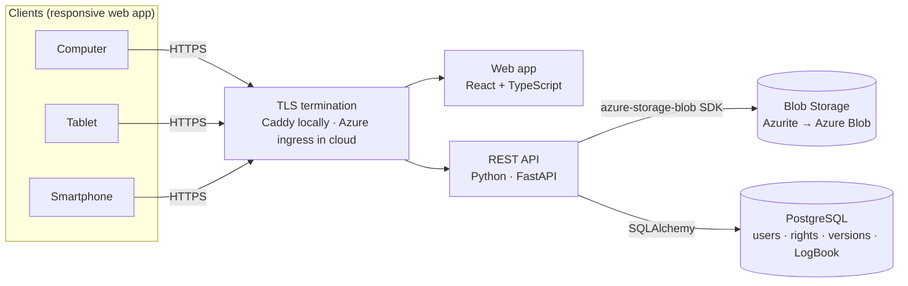
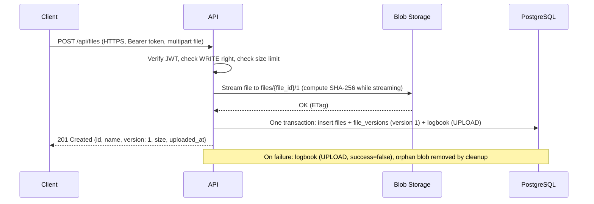
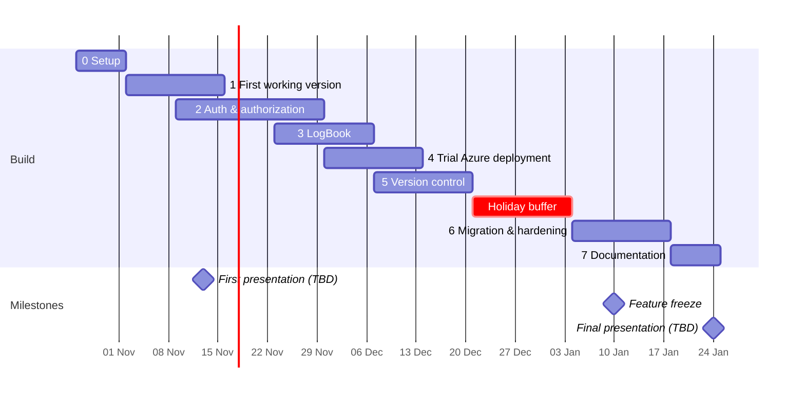

# Development Plan — Cloud File Exchange System

> How we build the system: architecture, requirements, data model, API, phases and Azure migration.
> Presentation content: [PRESENTATION.md](PRESENTATION.md)

## 1. Goal

A system for exchanging documents and photos between client devices (computer, tablet, smartphone) and the cloud.

- We develop locally with **Docker** and **Azurite** (the official Azure Storage emulator).
- When the system is complete, we migrate it to **Microsoft Azure**.
- The code is written so that the migration needs **configuration changes only**.

## 2. Requirements

### Functional

| ID | Requirement | Requirement level | Phase |
|---|---|---|---|
| FR1 | Login | Good grade | 2 |
| FR2 | Logout (session really ends: refresh token revoked) | Good grade | 2 |
| FR3 | Upload file | Necessary | 1 |
| FR4 | Download file | Necessary | 1 |
| FR5 | List files the user can read | Necessary | 1 |
| FR6 | Authorization: **read / write / update** rights | Good grade | 2 |
| FR7 | Version control: each version has a number, date and size; list versions | Very good grade | 5 |
| FR8 | Download a specific version; restore an older version | Very good grade | 5 |
| FR9 | LogBook: every login (success and failure), logout and file operation recorded in a database | LogBook (perfect) | 3 |
| FR10 | LogBook export to CSV / JSON; admin view with filters | LogBook (essential) | 3 |
| FR11 | Admin creates / deactivates users | Good grade | 2 |
| FR12 | Owner shares a file with another user (read or update) | Should | 2 |

### Non-functional

| ID | Requirement |
|---|---|
| NFR1 | All traffic over **HTTPS** (TLS 1.2+); plain HTTP refused or redirected |
| NFR2 | Files stored in **Azure Blob Storage** (Azurite locally) |
| NFR3 | Usable on computer, tablet and smartphone browsers (responsive layout) |
| NFR4 | Passwords stored only as **Argon2id** hashes; no secrets in the repository |
| NFR5 | Local → Azure migration with **configuration changes only** |
| NFR6 | Maximum file size **100 MB**; uploads streamed, never loaded fully into memory |
| NFR7 | Blob container is private; files are reachable only through the API |

### Out of scope

Native mobile/desktop apps · background folder sync · real-time co-editing · client-side encryption · self-registration · multi-region deployment.

## 3. Key design decision: versioning in the application

**Azurite does not support** Blob Versions, soft delete, immutability policies or user-delegation SAS ([Azurite README](https://github.com/Azure/Azurite)).

If we relied on Azure's built-in blob versioning, it would work in the cloud but not during local development. So versioning is part of our own code:

- Every upload creates a **new blob that is never modified**: `files/{file_id}/{version_no}`.
- The `file_versions` table stores the version number, date, size, SHA-256 hash and uploader.
- "Restore version n" copies blob n into a new version `current + 1`. The history is never rewritten.

This works the same on Azurite and on Azure.

## 4. Architecture



### Local vs Azure

| Component | Local (Docker Compose) | Azure |
|---|---|---|
| Web client | Vite dev server / static build | Azure Static Web Apps (Free tier) |
| HTTPS | Caddy with its own local CA (`tls internal`) | Managed TLS on Container Apps / Static Web Apps |
| API | `api` container (FastAPI + Uvicorn) | Azure Container Apps (consumption plan) |
| File storage | Azurite (blob service) | Storage account (StorageV2, LRS, secure transfer required, public access disabled) |
| Database | `postgres:16` container | Azure Database for PostgreSQL Flexible Server (Burstable B1ms) |
| Access to storage | Connection string (Azurite's well-known dev key) | **Managed identity** + role `Storage Blob Data Contributor` |
| Secrets | `.env` (gitignored) | Azure Key Vault |
| Monitoring | Container logs | Application Insights |
| Container images | Built locally | GitHub Container Registry (free) or Azure Container Registry |

### Upload flow



## 5. Authentication and authorization

### Login and logout
- **Login** `POST /api/auth/login`
  - The password is checked against an Argon2id hash.
  - The API returns:
    - a short-lived **access token** (JWT, 15 min), sent as `Authorization: Bearer …`
    - a **refresh token** (7 days), set as an `HttpOnly; Secure; SameSite=Strict` cookie and stored **hashed** in `refresh_tokens`
- **Logout** `POST /api/auth/logout` marks the refresh token as revoked. The access token expires within 15 minutes and cannot be renewed. This solves the problem that a JWT on its own can't be cancelled.
- **Brute-force protection:** rate-limit login attempts per IP and per username. Every failed attempt is recorded in the LogBook.

### Rights

| Right | Allows |
|---|---|
| **READ** | See the file in the list, view its versions, download any version |
| **WRITE** | Upload new files |
| **UPDATE** | Upload a new version of an existing file, restore an older version |

| Role | Default rights |
|---|---|
| `viewer` | READ on files shared with them |
| `user` | WRITE; full rights on files they own; READ/UPDATE on files shared with them |
| `admin` | Everything, plus user management and the LogBook |

- File owners grant READ or UPDATE to other users (`file_permissions` table).
- All checks happen in **one place**: a FastAPI dependency `require(right)`. This keeps rules consistent and testable.

## 6. Data model

```sql
users            (id, username UNIQUE, email, password_hash, role, is_active, created_at)
files            (id UUID, owner_id → users, name, content_type, current_version, created_at, deleted_at)
file_versions    (id, file_id → files, version_no, blob_name, size_bytes, sha256,
                  uploaded_by → users, uploaded_at,
                  UNIQUE (file_id, version_no))
file_permissions (file_id → files, user_id → users, can_read, can_update,
                  PRIMARY KEY (file_id, user_id))
refresh_tokens   (id, user_id → users, token_hash, issued_at, expires_at, revoked_at)
logbook          (id, ts, user_id, username, action, file_id, version_no,
                  ip, user_agent, success, details JSONB)
```

- **Blob naming:** container `files`, blob `{file_id}/{version_no}`. User-supplied file names are **never** used as blob paths, which prevents name collisions and path tricks. The original name is stored in `files.name` and sent back in `Content-Disposition` on download.
- **Simultaneous uploads:** the next version number is read with `SELECT … FOR UPDATE` on the `files` row. The `UNIQUE (file_id, version_no)` constraint is the safety net; on conflict, retry.
- **LogBook actions:** `LOGIN`, `LOGIN_FAILED`, `LOGOUT`, `LIST`, `UPLOAD`, `UPDATE` (new version), `DOWNLOAD`, `RESTORE`, `SHARE`, `DELETE`, `USER_CREATE`.

## 7. REST API

| Method | Path | Right | LogBook action |
|---|---|---|---|
| POST | `/api/auth/login` | — | `LOGIN` / `LOGIN_FAILED` |
| POST | `/api/auth/logout` | logged in | `LOGOUT` |
| POST | `/api/auth/refresh` | refresh cookie | — |
| GET | `/api/auth/me` | logged in | — |
| GET | `/api/files` | READ (filters list) | `LIST` |
| POST | `/api/files` | WRITE | `UPLOAD` |
| GET | `/api/files/{id}` | READ | — |
| GET | `/api/files/{id}/versions` | READ | — |
| POST | `/api/files/{id}/versions` | UPDATE | `UPDATE` |
| GET | `/api/files/{id}/download?version=n` | READ | `DOWNLOAD` |
| POST | `/api/files/{id}/versions/{n}/restore` | UPDATE | `RESTORE` |
| PUT | `/api/files/{id}/permissions` | owner | `SHARE` |
| DELETE | `/api/files/{id}` | owner / admin | `DELETE` (soft delete) |
| GET | `/api/logbook?user=&action=&from=&to=` | admin | — |
| GET | `/api/logbook/export?format=csv\|json` | admin | — |
| POST | `/api/users` | admin | `USER_CREATE` |

FastAPI generates the OpenAPI spec and a Swagger UI at `/docs`. We use them for testing and demos.

## 8. Repository layout (target)

```
Cloud-Computing-Systems/
├── README.md
├── docker-compose.yml
├── .env.example
├── Caddyfile
├── api/
│   ├── Dockerfile
│   ├── pyproject.toml
│   ├── app/
│   │   ├── main.py
│   │   ├── config.py        # all settings from environment variables
│   │   ├── db.py
│   │   ├── models.py
│   │   ├── storage.py       # the only module that talks to Blob Storage
│   │   ├── auth/            # login, logout, tokens, permission dependency
│   │   ├── files/           # upload, download, list, versions
│   │   └── logbook/         # logging service, admin endpoints, export
│   ├── migrations/          # Alembic
│   └── tests/
├── web/                     # React + TypeScript (Vite)
├── infra/                   # Azure deployment scripts (Bicep or az CLI)
└── docs/
    ├── PLAN.md
    ├── PRESENTATION.md
    └── report/
```

## 9. Local environment

### Docker Compose (sketch)

```yaml
services:
  azurite:
    image: mcr.microsoft.com/azure-storage/azurite
    command: azurite-blob --blobHost 0.0.0.0 --location /data --skipApiVersionCheck
    ports: ["10000:10000"]          # exposed for Azure Storage Explorer
    volumes: [azurite-data:/data]

  db:
    image: postgres:16
    environment:
      POSTGRES_DB: cloudfiles
      POSTGRES_USER: cloudfiles
      POSTGRES_PASSWORD: ${POSTGRES_PASSWORD}
    volumes: [db-data:/var/lib/postgresql/data]

  api:
    build: ./api
    env_file: .env
    depends_on: [azurite, db]

  web:
    build: ./web

  caddy:
    image: caddy:2
    ports: ["80:80", "443:443"]
    volumes:
      - ./Caddyfile:/etc/caddy/Caddyfile
      - caddy-data:/data
    depends_on: [api, web]

volumes:
  azurite-data:
  db-data:
  caddy-data:
```

```caddy
localhost {
    tls internal
    handle /api/* {
        reverse_proxy api:8000
    }
    handle {
        reverse_proxy web:5173
    }
}
```

### Configuration (environment variables)

| Variable | Local | Azure |
|---|---|---|
| `STORAGE_AUTH` | `connection_string` | `managed_identity` |
| `BLOB_CONNECTION_STRING` | `DefaultEndpointsProtocol=http;AccountName=devstoreaccount1;AccountKey=<well-known key>;BlobEndpoint=http://azurite:10000/devstoreaccount1;` | — |
| `BLOB_ACCOUNT_URL` | — | `https://<account>.blob.core.windows.net` |
| `BLOB_CONTAINER` | `files` | `files` |
| `DATABASE_URL` | `postgresql+psycopg://cloudfiles:…@db:5432/cloudfiles` | Key Vault reference |
| `JWT_SECRET` | random value in `.env` | Key Vault reference |
| `ACCESS_TOKEN_MINUTES` / `REFRESH_TOKEN_DAYS` | `15` / `7` | same |
| `MAX_UPLOAD_MB` | `100` | `100` |
| `CORS_ORIGINS` | `https://localhost` | Static Web App URL |

`storage.py` builds the client from these settings:
- `connection_string` → `BlobServiceClient.from_connection_string(...)`
- `managed_identity` → `BlobServiceClient(account_url, credential=DefaultAzureCredential())`

The rest of the code never knows which one it's using.

### Known pitfalls

- **Inside Compose, use the service name `azurite`, not `127.0.0.1`.** `UseDevelopmentStorage=true` points to `127.0.0.1`, which fails inside a container.
- `--skipApiVersionCheck` stops Azurite from rejecting requests from a newer SDK.
- The current `.gitignore` (Node template) ignores `.env.*`, which would also ignore `.env.example`. Add `!.env.example`, plus Python entries (`__pycache__/`, `.venv/`, `.pytest_cache/`).
- To test from a phone or tablet, use the machine's LAN hostname instead of `localhost`, and install Caddy's root certificate on the device. Alternatively, test devices against the Azure deployment.
- Neither Uvicorn nor Caddy limits upload size by default, so the API must enforce `MAX_UPLOAD_MB` while streaming.

## 10. Phases

Draft dates assume W1 starts **Mon 26 Oct 2026**. Align them with the course calendar and the presentation dates.



### Phase 0 — Setup (W1)
- [ ] Agree on the stack (default: FastAPI + React + PostgreSQL) and team roles
- [ ] Repo: protected `main`, feature branches, pull requests with one reviewer
- [ ] GitHub Projects board with one issue per task below
- [ ] `docker-compose.yml`, `.env.example`, `Caddyfile`; fix `.gitignore`
- [ ] GitHub Actions: lint + tests, with PostgreSQL and Azurite as service containers
- [ ] Azure for Students subscription + budget alert
- [ ] Azure Storage Explorer installed and connected to Azurite

### Phase 1 — First working version (W2–W3) · Necessary
- [ ] `storage.py`: create container, upload (streamed), download (streamed), list
- [ ] `POST /api/files`, `GET /api/files`, `GET /api/files/{id}/download`
- [ ] Minimal web page: file list, upload button, download links
- [ ] Everything reachable only via `https://localhost`
- [ ] **Demo ready for the first presentation**

### Phase 2 — Authentication & authorization (W3–W5) · Good grade
- [ ] `users` table, Alembic migrations, seed admin from environment variables
- [ ] Argon2id hashing (`argon2-cffi`), login, access + refresh tokens, refresh endpoint
- [ ] Logout revokes the refresh token
- [ ] Roles + `file_permissions`; `require(right)` dependency on every endpoint
- [ ] Admin endpoints: create / deactivate users
- [ ] Login rate limiting
- [ ] Web: login page, logout button, token handling, hide actions the user has no right to
- [ ] Tests: role × operation matrix, ID-guessing attempts, expired / revoked tokens

### Phase 3 — LogBook (W5–W6)
- [ ] `logbook` table and `log_event()` service, called from the auth and file services
- [ ] Record client IP and user agent; record failures too (`success = false`)
- [ ] `GET /api/logbook` with filters and pagination (admin only)
- [ ] CSV and JSON export
- [ ] Web: admin LogBook page
- [ ] Test: scripted scenario of N operations → exactly N entries

### Phase 4 — Trial Azure deployment (W6–W7)
- [ ] Deploy the current state with the steps in §11
- [ ] Note every local/cloud difference found, and fix it in code or config
- [ ] Scale to zero / stop the database afterwards to save credit

### Phase 5 — Version control (W7–W9) · Very good grade
- [ ] `file_versions` table; upload writes version 1
- [ ] `POST /api/files/{id}/versions` (new version), with locking against simultaneous uploads
- [ ] SHA-256 computed while streaming
- [ ] `GET /api/files/{id}/versions`; download by version; restore (copy to a new version)
- [ ] Web: version history panel (version, date, size, uploader) with Download / Restore buttons
- [ ] Tests: 3 uploads → versions 1–3 with correct sizes; v1 hash matches the original; parallel uploads get unique numbers

### Phase 6 — Final migration & hardening (W10–W11)
- [ ] Repeatable deployment script in `infra/`
- [ ] Managed identity for Blob access; secrets in Key Vault; Application Insights
- [ ] Security review against an OWASP ASVS checklist:
  - [ ] HSTS and security headers
  - [ ] CORS restricted to our origin
  - [ ] Generic error messages (no stack traces to clients)
  - [ ] Dependency audit
- [ ] Device testing: computer, tablet, smartphone (all six functions)
- [ ] Load check: 100 MB upload; list of 1,000 files
- [ ] Verify every measure of success (§13)

### Phase 7 — Documentation (W12)
- [ ] Final report (12–18 pages, outline in `Reportclasses.pdf`); ask the supervisor whether the older lab template applies too (cloud provider, security aspects, user guide, team roles)
- [ ] User guide with screenshots (collect them throughout the project)
- [ ] Final presentation + backup demo video
- [ ] Delete or scale down Azure resources after grading

## 11. Azure migration steps

1. **Resource group** `rg-cloudfiles` in a nearby region (e.g. Poland Central / West Europe).
2. **Storage account:**
   - StorageV2, LRS
   - minimum TLS 1.2, secure transfer required, blob public access disabled
   - private container `files`
3. **PostgreSQL Flexible Server**, Burstable B1ms:
   - SSL required
   - firewall limited to Azure services
   - run Alembic migrations
4. **Key Vault:** store `JWT_SECRET` and `DATABASE_URL`.
5. **Container image:** push the API image to GHCR or ACR.
6. **Container Apps:**
   - create the environment and the `api` app (external ingress, HTTPS only)
   - enable a system-assigned **managed identity**
   - grant it `Storage Blob Data Contributor` on the storage account and secret access to Key Vault
   - set `STORAGE_AUTH=managed_identity`
7. **Static Web Apps:** deploy `web/` and set the API URL and CORS origin.
8. **Application Insights** connected to the API.
9. **Smoke test:** run the same scripted scenario used locally (login → upload → new version → download → logout), then check the LogBook.

The Container Apps consumption plan includes 180,000 vCPU-seconds, 360,000 GiB-seconds and 2 million requests per subscription per month for free ([pricing](https://azure.microsoft.com/en-us/pricing/details/container-apps/)). PostgreSQL is the main cost, so stop it when it isn't needed.

## 12. Testing strategy

| Level | Tool | What |
|---|---|---|
| Unit | pytest | Rights logic, version numbering, token handling |
| Integration | pytest + httpx, with Azurite and PostgreSQL in CI | Every endpoint; role × operation matrix; LogBook entries |
| End-to-end | Manual checklist (optionally Playwright) | The six functions on computer, tablet and phone |
| Security | OWASP ASVS checklist, `pip-audit` / `npm audit` | Access control, headers, dependencies |
| Cloud smoke test | Scripted scenario | Same scenario on Azurite and on Azure |

**Definition of done (per feature):** code reviewed in a pull request · tests pass in CI · the action is recorded in the LogBook · a user-guide screenshot is saved.

## 13. Measures of success

| # | Criterion | Verification |
|---|---|---|
| M1 | All six functions work on the Azure deployment | Demo on computer, tablet, smartphone |
| M2 | HTTPS only | `curl http://…` refused / redirected; secure transfer required on storage |
| M3 | Rights enforced | Role × operation test matrix 100% pass |
| M4 | Version control correct | 3 uploads → versions 1–3, correct date/size, v1 SHA-256 matches original |
| M5 | LogBook complete | N scripted operations → N entries; CSV/JSON export |
| M6 | Credentials safe | Argon2id hashes only; no secrets in Git history |
| M7 | Portable | Azurite → Azure with configuration changes only |
| M8 | Quality | CI green on the final version |

## 14. Team organization

| Role | Responsibilities | Member |
|---|---|---|
| Backend & security | Auth, rights, tokens, security review | _TBD_ |
| Storage & version control | `storage.py`, versioning, LogBook | _TBD_ |
| Frontend | Web app, responsive layout, user guide screenshots | _TBD_ |
| DevOps & Azure | Docker, CI, Azure deployment, cost monitoring | _TBD_ |

With fewer members, merge roles: *Backend + Storage* and *Frontend + DevOps*. Everyone contributes to the report.

**Communication:**
- Weekly meeting (_TBD_ day/time)
- Team chat channel
- GitHub Projects board as the single task list
- Every pull request reviewed by one other member
- A short "who did what" log kept in `docs/report/` for the team-roles chapter

## 15. Open decisions

- [ ] Backend language: FastAPI (default) vs Node.js or .NET. The repo's `.gitignore` is the Node template; confirm the choice.
- [ ] Presentation dates and lengths
- [ ] Which report template the supervisor expects
- [ ] Self-registration vs admin-created accounts (default: admin-created)
- [ ] Optional: Microsoft Entra ID login instead of our own accounts (stretch goal; can't be emulated locally)
