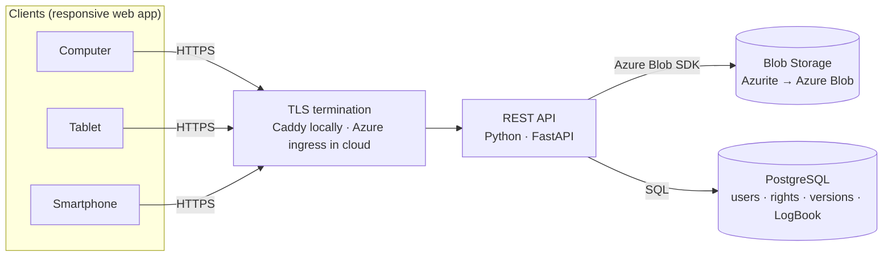

# First Presentation — Cloud File Exchange System

> Content for the first project presentation, slide by slide.
> Each slide has **On the slide** (what to show) and **Speaker notes** (what to say).
> The same content becomes chapters 1–3 of the final report, so keep it up to date.
>
> Development plan: [PLAN.md](PLAN.md)

| | |
|---|---|
| **Course** | Cloud Computing Systems — Laboratory |
| **Team** | _TBD_ |
| **Supervisor** | _TBD_ |
| **Presentation date** | _TBD_ |
| **Length** | ~15 min + Q&A (adjust timings if different) |

## Slide overview

| # | Slide | Section | Time | Speaker |
|---|---|---|---|---|
| 1 | Title | — | 0:30 | B |
| 2 | Problem statement / idea | 1 | 1:30 | B |
| 3 | Challenge | 1 | 1:30 | B |
| 4 | Approach | 1 | 1:30 | D |
| 5 | Outcome (expected + status) + live demo | 1 | 1:00 (+ ~1:00 demo) | D |
| 6 | Research | 2 | 1:00 | C |
| 7 | Related work | 2 | 1:30 | C |
| 8 | Detailed comparison of three solutions | 2 | 2:00 | C |
| 9 | Objectives and limits | 3 | 1:30 | A |
| 10 | Sources | 3 | 0:30 | A |
| 11 | Tools and technologies | 3 | 1:00 | A |
| 12 | Risks | 3 | 1:00 | A |
| 13 | Measures of success | 3 | 1:00 | D |
| 14 | Schedule and team | — | 0:30 | D |
| 15 | Questions | — | — | everyone, by area |

Speakers use the role letters from [PLAN.md §14](PLAN.md#14-team-organization): **A** Backend & security · **B** Storage & version control · **C** Frontend · **D** DevOps & Azure. Speaking time: A 4:00 · B 3:30 · C 4:30 · D 4:00 + demo. Total is ~16 min plus the demo, so trim slides 7–8 if the run-through goes over.

---

## Slide 1 — Title

**On the slide**
- **Cloud File Exchange System**: secure upload, download and versioning of documents and photos on Microsoft Azure
- Team members, supervisor, date, university logo

---

# 1. Problem statement / idea

## Slide 2 — Problem statement / idea

**On the slide**
- People work on several devices (computer, tablet, smartphone) and need the same documents and photos everywhere.
- Copying files by e-mail or USB leads to lost files, unclear versions, and no record of who changed what.
- **Idea:** a cloud system where any device can log in, upload, download and list files over HTTPS. Every file keeps a version history and every action is recorded in a LogBook.

| Requirement level | Scope |
|---|---|
| Necessary | File transfer over HTTPS; files stored in the cloud (Azure) |
| Good grade | Login, authentication, authorization (read / write / update rights) |
| Very good grade | File version control (date, size, version) |
| LogBook | Record of logins and file operations: text file (essential), database (perfect) |

**Speaker notes**
Start from the user's view: "I took a photo on my phone and need it on my laptop, and I want the version from yesterday back." Then show that the brief asks for exactly these features at increasing grade levels, and that we aim for all of them.

---

## Slide 3 — Challenge

**On the slide**

What we expect to be most difficult:

1. **Security from end to end**
   - Authentication and per-file **read / write / update** rights, always checked on the server
   - **Logout** with token-based login: tokens are self-contained, so logging out means they must be revoked
2. **Consistent version control**
   - Saving the file (Blob Storage) and saving its metadata (database) are two separate steps that can't be done as one transaction
   - Two users uploading a new version of the same file at the same time must not get the same version number
3. **Local vs cloud parity**
   - We develop locally with the **Azurite** emulator and move to Azure at the end
   - Azurite does **not** support Azure's blob versioning, soft delete or user-delegation SAS, so the design must not depend on them
4. **Many device types and large files**: one interface for PC, tablet and phone; uploads over slow mobile networks

**Speaker notes**
Point 3 came out of our research: the obvious solution (turn on Azure Blob versioning) would not work locally, so we implement versioning ourselves. That turns the "very good grade" feature into our own code rather than a portal setting.

---

## Slide 4 — Approach

**On the slide**

- **One responsive web app** serves computer, tablet and smartphone from one codebase.
- **The API** checks the token and the user's rights, streams files to/from Blob Storage, and records every action in the LogBook.
- **Each version is its own blob** (`files/{fileId}/{version}`); its date, size, hash and uploader are stored in the database.
- **Docker Compose** runs everything locally (Azurite + PostgreSQL + API + web + HTTPS proxy). The same containers then move to Azure, changing only configuration.

**Speaker notes**
Walk through one upload: HTTPS request → token checked → write right checked → file streamed to Blob Storage → version row saved → LogBook entry written.

---

## Slide 5 — Outcome

**On the slide**
- **Target outcome:** all four requirement levels: HTTPS + Azure storage, authentication and authorization, version control, and a LogBook in a database.
- **Current status (update before presenting):**
  - [ ] Local environment running (Azurite + PostgreSQL in Docker)
  - [ ] Upload / list / download working over HTTPS
  - [ ] Architecture and data model defined
- **Final result:** to be reported as success / partial success / failure at the end, judged against the measures of success (slide 13)

**Speaker notes**
The project has just started, so we present the expected outcome and what already works. If possible, show a 30-second live demo of an upload to Azurite and the file appearing in the list. Have a screen recording ready as a backup.

---

# 2. State of the art

## Slide 6 — Research

**On the slide**

| Method | Sources |
|---|---|
| Documentation review | Microsoft Learn (Azure Blob Storage, Azurite, Container Apps, Entra ID), Azurite GitHub repository, FastAPI and Docker docs |
| Security standards | OWASP ASVS and Cheat Sheets (Authentication, Session Management, File Upload), NIST SP 800-63B, RFC 7519 (JWT), RFC 9106 (Argon2), RFC 9110 (HTTP), RFC 8446 (TLS 1.3) |
| Scientific literature | Drago et al., 2012, *Inside Dropbox: Understanding Personal Cloud Storage Services* (ACM IMC); Drago et al., 2013, *Benchmarking Personal Cloud Storage* (ACM IMC) |
| Hands-on product testing | Free accounts on Dropbox, OneDrive, Google Drive and a Nextcloud demo, tested against the same checklist: login, sharing rights, version history, activity log |
| Prototyping | Small test programs against Azurite to confirm which Blob features work locally |

**Speaker notes**
The prototyping step is how we found that Azurite doesn't support blob versioning, which changed the design.

---

## Slide 7 — Related work

**On the slide**

| Solution | Type | Advantages | Disadvantages |
|---|---|---|---|
| **Google Drive** | Hosted service | 15 GB free; strong real-time collaboration (Docs/Sheets) | Uploaded files keep versions for 30 days / 100 versions unless marked "keep forever"; closed |
| **Dropbox** | Hosted service | Very good sync engine; clients for all platforms | Small free tier; version history length depends on plan |
| **Microsoft OneDrive** | Hosted service (Microsoft cloud) | Built into Windows and Office; enterprise identity (Entra ID) | Personal accounts keep only the last 25 versions; tied to the Microsoft ecosystem |
| **Box** | Hosted service (enterprise) | Fine-grained collaborator roles; strong governance and auditing | Business-focused and expensive; limits on the free plan |
| **iCloud Drive** | Hosted service | Seamless on Apple devices | Weak on Windows/Android; few sharing controls |
| **Nextcloud / ownCloud** | Open source, self-hosted | Full data control; plugins; can use S3 or Azure Blob as storage | You run and maintain it yourself; heavy PHP stack |
| **Seafile** | Open source, self-hosted | Fast, splits files into blocks and stores each block once | Smaller community and ecosystem |
| **Azure Storage Explorer / AWS S3 console** | Developer tools | Direct access to cloud storage | For admins only: no end-user accounts, rights model or LogBook |

**Speaker notes**
All commercial products solve the problem but are closed, and full audit logs are usually limited to paid business plans. The self-hosted options are closest to what we build, but much heavier.

---

## Slide 8 — Detailed comparison of the three most similar solutions

**On the slide**

| Criterion | Dropbox | OneDrive | Nextcloud | **Our system** |
|---|---|---|---|---|
| Hosting | Hosted by Dropbox | Hosted by Microsoft (Azure) | Self-hosted; S3 / Azure Blob as storage | Our Azure subscription |
| Clients | Web, desktop, mobile apps | Web, desktop, mobile; built into Windows | Web, desktop, mobile apps | One responsive web app (PC, tablet, phone) |
| Transport | HTTPS | HTTPS | HTTPS (if the admin configures it) | HTTPS only; plain HTTP refused |
| Authentication | Account + 2FA; single sign-on on business plans | Microsoft account / Entra ID, MFA | Local users, LDAP, SAML/OIDC, 2FA | Own accounts, Argon2 password hashes, JWT tokens |
| Rights | View / edit on shared folders and links | View / edit, sharing links | Read, edit, create, delete, reshare | **Read / write / update** per file, plus roles |
| Version control | 30 days (Basic/Plus), 180 days (Business), 365 days (Advanced) | Last 25 versions (personal) | Versions app: fewer versions kept as they age; max 50% of free space | Every version kept with date, size, version no., hash; restore any version |
| Activity / audit log | Admin activity log on business plans | Microsoft 365 audit log (business) | Activity app + admin audit log | **LogBook** in the database for every login and file operation; CSV/JSON export |
| Cost | Freemium | Freemium / Microsoft 365 | Free software; you pay for hosting | Azure pay-as-you-go (student credit) |
| Main weakness | Closed; short history on cheap plans | Microsoft ecosystem only | Complex to operate | Fewer features; no desktop sync |

**What we take from them**
- Dropbox / OneDrive: a simple version-history view with "restore this version".
- Nextcloud / Box: per-file rights separated by action (read vs edit).
- Nextcloud: an activity log available to administrators.

**Speaker notes**
We picked these three because they cover the three types: a sync pioneer (Dropbox), the Azure-based Microsoft product (OneDrive), and the self-hosted open-source equivalent (Nextcloud), which is architecturally closest to our project. Vendor figures were checked on the vendors' sites in Oct 2026; re-check them before presenting.

Sources: [Dropbox version history](https://help.dropbox.com/delete-restore/version-history-overview) · [Nextcloud file versioning](https://docs.nextcloud.com/server/stable/admin_manual/configuration_files/file_versioning.html) · [OneDrive version history discussion](https://techcommunity.microsoft.com/t5/onedrive-for-business/how-long-does-onedrive-for-business-keep-version-history-how/td-p/99669)

---

# 3. Short project specifications and requirements

## Slide 9 — Objectives and limits

**On the slide**

| Priority | Objective | Requirement level |
|---|---|---|
| **Must** | Upload, download and list files over **HTTPS**; files stored in **Azure Blob Storage** | Necessary |
| **Must** | **Login / logout**, authentication, authorization with **read / write / update** rights | Good grade |
| **Must** | **Version control**: version number, date and size of every version; download or restore any version | Very good grade |
| **Must** | **LogBook** of logins and file operations in a **database**, exportable to CSV/JSON | LogBook (perfect level) |
| Should | Same app usable on computer, tablet and smartphone (responsive / installable web app) | — |
| Should | Admin view of the LogBook with filters (user, action, date) | — |
| Could | File sharing between users, image previews, direct uploads via SAS | — |

**Rights model**
- **Read**: see the file in the list and download any version
- **Write**: upload new files
- **Update**: upload a new version of an existing file, restore an older version
- The **owner** can grant rights on a file to other users; the **admin** manages users and reads the LogBook

**Limits (out of scope)**
- No native mobile or desktop apps (one responsive web app instead)
- No background folder sync and no real-time co-editing
- No client-side (end-to-end) encryption
- No self-registration; the admin creates accounts
- Maximum file size **100 MB**; single Azure region

---

## Slide 10 — Sources

**On the slide**
- **Documentation:** Microsoft Learn (Azure Storage, Azurite, Container Apps, Key Vault, managed identities), FastAPI, Docker
- **Standards:** OWASP ASVS and Cheat Sheet Series, NIST SP 800-63B, IETF RFCs 7519, 9106, 9110, 8446
- **Books:** Erl, Mahmood and Puttini, 2013, *Cloud Computing: Concepts, Technology & Architecture*; Kleppmann, 2017, *Designing Data-Intensive Applications*
- **People / organizations:** course supervisor; Microsoft Q&A and the Azure for Students programme; Stack Overflow / GitHub issues (Azurite repository)

---

## Slide 11 — Tools and technologies

**On the slide**

| Tool / technology | Purpose | Why this choice |
|---|---|---|
| **Microsoft Azure** | Cloud provider | Required by the brief; Azure for Students credit; Blob Storage built for files |
| **Azure Blob Storage** | File storage | Object storage for unstructured data (documents, photos); cheap; durable; HTTPS-only option |
| **Azurite (Docker)** | Local Blob emulator | Official, free, offline; same API and SDK as Azure, so no cloud cost during development |
| **Docker + Docker Compose** | Local environment | The same setup on every team member's machine; the same images deploy to Azure |
| **Python + FastAPI** | REST API | Fast to develop; streams uploads; automatic Swagger UI for testing and demos |
| **PostgreSQL** | Users, rights, versions, LogBook | Relational data with transactions; Azure has a managed version (Flexible Server) |
| **React + TypeScript (Vite)** | Web client | One responsive app for PC, tablet and phone |
| **Caddy** | HTTPS locally | Sets up local TLS certificates automatically |
| **Azure Container Apps / Static Web Apps** | Cloud hosting | Runs our containers directly; free monthly allowance; managed HTTPS |
| **Azure Key Vault + managed identity** | Secrets | No passwords or connection strings in code or config |
| **GitHub + GitHub Actions** | Code, tasks, CI | Pull-request reviews, a task board, automated tests on every push |

---

## Slide 12 — Risks

**On the slide**

| # | Risk | Likelihood | Impact | Mitigation |
|---|---|---|---|---|
| R1 | Differences between Azurite and Azure discovered only at migration | Medium | High | **Trial deployment to Azure mid-project**; use only core Blob features |
| R2 | Broken access control (reaching other users' files by guessing IDs), leaked secrets | Medium | High | One central permission check; tests for every role × operation; secrets never committed |
| R3 | File and database out of sync; two uploads getting the same version number | Medium | Medium | Save the file first, then the version row in a transaction with a uniqueness rule; retry on conflict |
| R4 | Azure credit used up | Medium | Medium | Student credit, free tiers, a budget alert, scale to zero when idle |
| R5 | Phones/tablets reject the local self-signed certificate during tests | High | Low | Install the local CA on test devices, or test devices against the Azure deployment |
| R6 | Large uploads time out on slow networks | Medium | Medium | Streamed uploads, a size limit, clear error messages |
| R7 | Too much scope, too little time | High | High | Build in requirement-level order; fixed feature-freeze date |
| R8 | Team coordination and integration problems | Medium | Medium | Task board, weekly meeting, pull-request reviews, CI |

---

## Slide 13 — Measures of success

**On the slide**

| # | Criterion | How we verify it |
|---|---|---|
| M1 | All six functions (login, logout, upload, download, list, LogBook) work on the **Azure** deployment | Demo from a computer, a tablet and a smartphone |
| M2 | All traffic uses HTTPS | `curl http://…` is refused or redirected; storage account has "secure transfer required" |
| M3 | Rights are enforced | Automated test matrix (role × operation): 100% pass; no access to other users' files by changing IDs |
| M4 | Version control is correct | Upload the same file 3× → versions 1–3 with correct date and size; downloaded v1 has the same SHA-256 as the original |
| M5 | LogBook is complete | A scripted run of N operations produces exactly N entries (failed logins included); CSV/JSON export works |
| M6 | Credentials are safe | Passwords stored only as Argon2 hashes; no secrets in the Git history |
| M7 | Portable from local to cloud | Moving from Azurite to Azure needs **configuration changes only** |
| M8 | Quality | CI test suite passes on the final version |

---

## Slide 14 — Schedule and team

**On the slide**

| Phase | Weeks | Result |
|---|---|---|
| 0. Setup | W1 | Repository, Docker environment, CI |
| 1. First working version | W2–W3 | Upload / list / download over HTTPS to Azurite |
| 2. Authentication & authorization | W3–W5 | Login, logout, read/write/update rights |
| 3. LogBook | W5–W6 | Database LogBook, admin view, export |
| 4. Trial Azure deployment | W6–W7 | Current version running on Azure |
| 5. Version control | W7–W9 | Version history, download / restore versions |
| 6. Migration & hardening | W10–W11 | Final Azure deployment, security review |
| 7. Documentation | W12 | Final report, user guide, final presentation |

| Role | Member |
|---|---|
| A — Backend & security | _TBD_ |
| B — Storage & version control | _TBD_ |
| C — Frontend | _TBD_ |
| D — DevOps & Azure | _TBD_ |

---

## Slide 15 — Questions

**On the slide**
- Thank you. Questions?
- Repository link

---

## Checklist before presenting

| Task | Owner |
|---|---|
| Fill in team names, supervisor and date | A |
| Build the shared slide deck from this file (one template, everyone fills their own slides) | C |
| Re-check vendor figures on slides 7–8 | C |
| Export the Mermaid diagram (slide 4) as an image for the slides | D |
| Update slide 5 with what actually works (the day before) | D |
| Prepare the live demo **and** a backup screen recording | D (B checks the storage part) |
| Have the Azurite prototype output ready as evidence for slide 6 | B |
| Time a full run-through (target ~15 min); at least two rehearsals | everyone |
