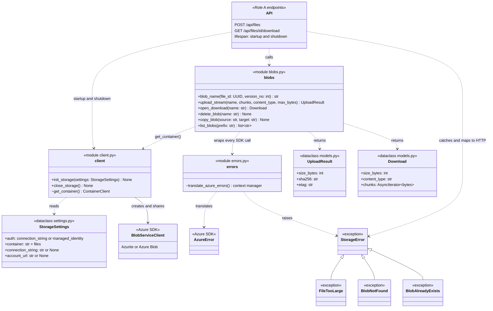

# Storage package (`api/app/storage`)

> Owner: Role B · Plan: [PLAN.md §3, §6, §9](PLAN.md) · Evidence: [Azurite has no blob versioning](evidence/azurite-versioning.txt)

The `storage` package is the only code that talks to Blob Storage (Azurite locally, Azure in the cloud). It knows nothing about users, rights or the database. The API endpoints check rights, write the database rows and turn the storage errors into HTTP responses.

- One private container (`files` by default) with one blob per file version, named `{file_id}/{version_no}`.
- Blobs are never overwritten: a new version is always a new blob.
- Uploads and downloads are streamed in chunks of `CHUNK_SIZE` (4 MiB), so a file is never held fully in memory.
- No Azure SDK type or exception leaves the package. Callers only write `from app import storage`.

## Package layout

| Module | Contents |
|---|---|
| `__init__.py` | Re-exports the public names, so callers use `storage.upload_stream(...)` etc. |
| `settings.py` | `StorageSettings`, `CHUNK_SIZE` |
| `models.py` | `UploadResult`, `Download` |
| `errors.py` | `StorageError` and its subclasses; `translate_azure_errors` (internal) |
| `client.py` | `init_storage`, `close_storage`; `get_container` (internal) |
| `blobs.py` | Blob operations: `blob_name`, `upload_stream`, `open_download`, `delete_blob`, `copy_blob`, `list_blobs` |

## Class diagram

`+` public (re-exported from `app.storage`) · `~` internal to the package



## Errors

| Error | When | Suggested API response |
|---|---|---|
| `FileTooLarge` | The upload went over `max_bytes`. Nothing was stored. | `413 Payload Too Large` |
| `BlobNotFound` | The blob does not exist. | `404 Not Found` |
| `BlobAlreadyExists` | The blob name is taken, e.g. two parallel uploads chose the same version number. Nothing was written. | Retry with the next version number |
| `StorageError` | Any other Blob Storage failure, e.g. storage unreachable. | `503 Service Unavailable` with a generic message |

The original Azure exception stays attached as `__cause__` for logging.

## Using it from the API

Build the settings from the environment ([PLAN §9](PLAN.md#9-local-environment)) and open the shared client once, in the FastAPI lifespan:

```python
import os
from contextlib import asynccontextmanager

from fastapi import FastAPI

from app import storage


@asynccontextmanager
async def lifespan(app: FastAPI):
    await storage.init_storage(
        storage.StorageSettings(
            auth=os.environ["STORAGE_AUTH"],
            container=os.environ.get("BLOB_CONTAINER", "files"),
            connection_string=os.environ.get("BLOB_CONNECTION_STRING"),
            account_url=os.environ.get("BLOB_ACCOUNT_URL"),
        )
    )
    yield
    await storage.close_storage()
```

Upload and download examples are in the docstrings of `upload_stream` and `open_download` in [`blobs.py`](../api/app/storage/blobs.py).

## Tests

Integration tests against a real Azurite, no mocks: [`api/tests/test_storage.py`](../api/tests/test_storage.py). From the `api/` folder, with Azurite listening on `127.0.0.1:10000`:

```bash
pip install -e ".[dev]"
python -m pytest
```
